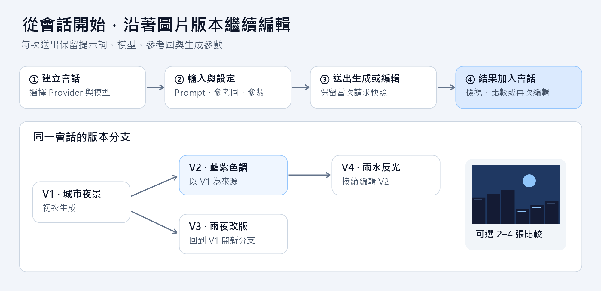

# Image Studio 功能規劃

Image Studio 是以會話組織生成、比較與多輪編輯的本機優先圖片工作台。規格依據補充的產品規劃全文與最後一版 RWD 方案。工作台可直接使用本機示範、連接 Standalone Provider，或在配置完成的 LiteLLM Dashboard 中以插件模式開啟。兩種啟動方式共用會話、Composer、版本比較與本機資料管理。 [分享對話](https://chatgpt.com/s/t_6af936c20c808191bab8bad0d7c574fa) · [工作台入口](../react-project/app/routes/home.tsx) · [設定與部署](../react-project/README.md)

[介面規格](./02-interface.md) · [設計系統](./03-design-system.md) · [技術架構](./04-architecture.md)

## 工作流程

從 V1 開啟新一輪編輯時，結果會接回 V1。圖中 V3 與 V2 同屬 V1 的分支，仍可與其他版本一起比較。

1. 建立或開啟會話，在底部 Prompt Composer 選擇 Generate 或 Edit，輸入提示詞並依模型能力加入參考圖。
2. 在 Composer 調整 Prompt Enhance（PE）、解析度、Seed 與 Extra Body。送出前驗證當前模式、附件及參數。
3. 當前會話顯示生成中的任務與可用操作。完成後，將結果加入會話畫布及該會話的圖片歷史，顯示版本與實際尺寸。
4. 開啟圖片 Viewer，或從歷史加入參考圖繼續編輯。會話歷史提供 Grid、Timeline 與 Versions 三種檢視方向。

## 功能範圍

| 功能 | 行為 |
|---|---|
| 會話 | 新建、搜尋、切換、重新命名、置頂、封存、刪除、複製及從圖片建立會話。各會話保存自己的 Provider、模型及預設生成參數，單次生成可覆寫。會話從最後一則對話起算，預設保留 30 天。 |
| 本會話圖片 | 顯示當前會話的生成、編輯版本及參考圖。提供檢視、比較選取圖片與加入 Composer。 |
| 全域圖片庫 | 瀏覽目前身分空間的生成圖片與上傳圖片，可從其他會話選圖作為參考，也可下載單張圖片。 |
| 圖片比較 | 支援原圖與結果並排、兩張圖片的 Before／After 滑桿、2–4 張並排比較及同步縮放。圖片資訊包含 Prompt、模型、Seed、尺寸與時間。 |
| 多輪編輯 | Composer 的「沿用最新圖」是會話開關，預設關閉。開啟時立即套用已有的最新結果；之後每次生成或編輯完成，自動將同一會話的最新結果設為第一張來源圖，並保留其他參考圖。關閉後保留目前附件。也可選擇任意舊版本開分支。每輪保留快照與來源關係。 |
| Provider Profiles | Standalone 可管理多個 Profile，含 Base URL、API Key、模型與個別 Generation／Edit Endpoint，支援取得模型清單、手動設定及連線測試。Plugin 登入後可輸入個人的 Virtual Key，從瀏覽器直連 Gateway 取得模型。 |
| 本機資料管理 | 會話、訊息、圖片與參數存在瀏覽器的 IndexedDB。提供完整備份與還原、單獨匯出會話、清理孤立圖片與縮圖。 |

## Prompt Composer

| 控制項 | 行為 |
|---|---|
| Generate / Edit | 模式決定可用參數及引用圖片的規則，並載入各自的 Extra Body。 |
| 多張參考圖 | 支援選檔、拖放、貼上，以及從歷史加入。送出前可移除、排序及檢視，排序代表引用優先順序。 |
| Prompt Enhance | Images API 預設送出 enhance_prompt 字串 true，可關閉或選擇 Auto Enhance。 |
| 解析度 | 生成預設為 1024 × 1024，編輯預設按第一張來源圖的比例縮放至約 1 MP。各模式分別記住手動選擇。提供比例、目標 MP、自訂寬高，送出前顯示對齊後的實際輸出尺寸。 |
| Seed | 提供 Random、Fixed、Manual。Random 每次產生新值，Fixed 重用固定值，Manual 輸入當次值。每次生成保存實際使用的 Seed；模型沒有此能力或未回報時，以對應狀態呈現。 |
| Extra Body | Generation 與 Edit 分別保存 JSON 物件。提供格式驗證、欄位衝突提示及 Request Preview。完成後套用至所編輯的模式。 |

### 實作提案

- **送出快照。** 記錄 Provider、模型、模式、原始／增強／實際送出的 Prompt、參考圖 ID 順序、Seed、解析度與 Extra Body。結果保留快照關聯及實際輸出尺寸，來源圖已存在時記錄父版本。
- **PE 審閱。** Off 直接使用原文。Auto 生成候選，供使用者複製、修改或採用。Provider Native 依模型契約呈現可審閱候選或後端處理狀態。增強失敗時保留草稿，可重試或使用原文。
- **多圖送出。** Composer 依選定模型顯示張數上限與格式限制。送出時維持使用者看到的引用順序。原比例的基準圖與 Edit 的來源圖角色須在 Provider 能力規格中明訂。
- **Extra Body 驗證。** 區分草稿與已套用值，提供 JSON 自動補全及錯誤位置。格式錯誤時停用套用。欄位衝突預設採 UI 值並顯示警告，使用者可明確選擇覆寫允許的欄位。可檢查實際 Request 與敏感資料已遮蔽的原始 Response。
- **任務回饋。** 顯示處理中、完成、失敗及取消狀態。Provider 有進度或取消能力時對應呈現。失敗可從原請求快照重試，並保留使用者目前正在編輯的草稿。

## 交付順序與驗收

| 階段 | 交付與驗收 |
|---|---|
| 1 · 啟動與工作區 | 以現有 React Router 骨架完成 Plugin Manifest、SSO 與雙模式切換。同階段以測試資料完成 RWD 工作區、Composer 與 Extra Body 側板。驗證直接開啟與 iframe 登入流程。 |
| 2 · 可用的生成與編輯 | 接上瀏覽器直連的 Provider Adapter 和模型清單。完成 Generate、Edit、參考圖順序、版本關係與 IndexedDB 保存，驗證重開後可用同一來源圖繼續編輯。 |
| 3 · 參數與資產工具 | 完成比例／MP、Seed、PE、Extra Body 的實際送出，以及比較、Timeline、Versions、全域圖片庫和資料匯入匯出。以 Request Preview 與實際請求核對參數。 |
| 後續擴充 | 完整佇列與批次生成、更多 Provider 能力偵測與 PWA。 |

## 待確認

- 實際部署使用的 LiteLLM 版本、允許的父視窗來源、Gateway 授權及預算策略，以及 Standalone Provider 的初期支援名單。
- 各模型的參考圖上限、來源圖角色、尺寸對齊、Seed 範圍、進度／取消能力，以及 Provider Native PE 是否回傳改寫結果。
- 備份封裝格式、會話刪除的連動規則，以及保留跨會話或分支引用的清理行為。
- 手機抽屜的進階篩選、排序及批次管理屬分享頁的延伸題目。原規劃已涵蓋會話搜尋、歷史選取、比較及加入參考圖，進階管理的首版範圍待定。
