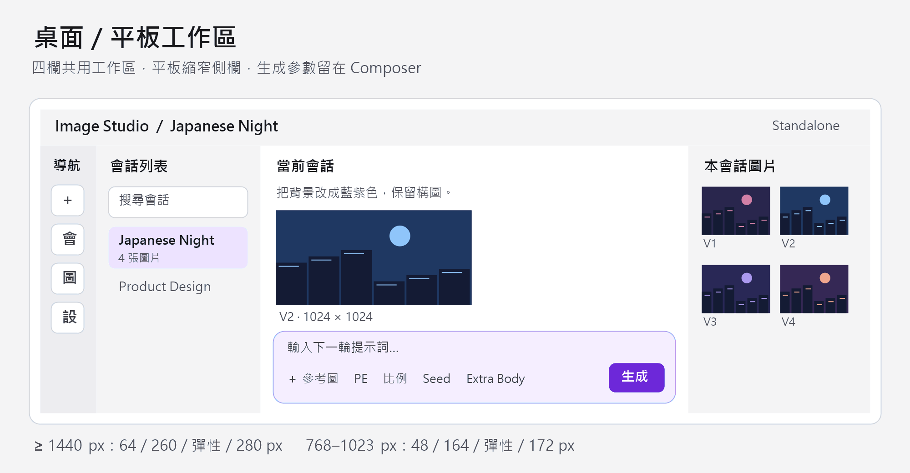
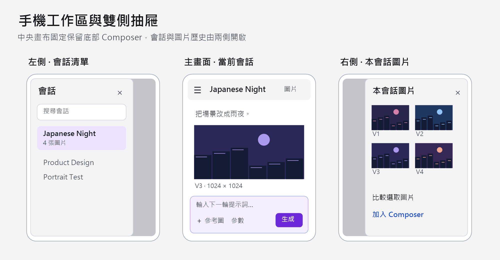

# Image Studio 介面規格

桌面與平板共用四欄工作區，手機使用單一會話畫布及左右抽屜。各寬度共用當前會話、Composer 草稿和參考圖順序。LiteLLM Plugin 與 Standalone 共用版面，依模式更新 Header 的身分、狀態及設定入口。 [分享對話](https://chatgpt.com/s/t_6af936c20c808191bab8bad0d7c574fa)

[功能規劃](./01-features.md) · [設計系統](./03-design-system.md) · [技術架構](./04-architecture.md)

## 工作區與斷點

平板沿用四欄結構並縮窄側欄。中央欄集中呈現結果與下一輪編輯操作。

| 視窗寬度 | 功能導航 | 會話列表 | 當前會話 | 本會話圖片 |
|---|---:|---:|---|---:|
| ≥ 1440 px | 64 px | 260 px | 彈性 | 280 px |
| 1024–1439 px | 64 px | 240 px | 彈性 | 240 px |
| 768–1023 px | 48 px | 164 px | 彈性 | 172 px |
| < 768 px | Header 的更多選單 | 左抽屜 | 全寬 | 右抽屜 |

中尺寸桌面的欄寬採原規劃範圍中的建議值。768 px 時中央寬度為 384 px，側欄分隔線計入各欄寬度。平板可縮短次要標籤及縮圖尺寸。欄內長標題截斷，完整名稱可由輔助技術取得。

桌面與平板的功能欄提供新建會話、會話、圖片庫、收藏與 Presets、Provider、設定。會話列表、本會話圖片及訊息區各自垂直捲動。Header 留在頂部，Composer 位於會話欄底部並隨輸入高度調整。工作區高度採動態 viewport，Composer 底部納入安全區域。

## 手機

左右圖各代表一次獨立的抽屜開啟狀態。右抽屜選圖後可比較，或將圖片加入 Composer。

- **Header。** 左側開啟會話抽屜，中間顯示產品及目前會話名稱，右側開啟本會話圖片抽屜。更多選單收納全域功能、模式、帳號與設定。
- **左側抽屜。** 提供新建會話、搜尋與會話清單。選取會話後關閉抽屜，更新中央畫布與本會話圖片。
- **右側抽屜。** 顯示本會話圖片數、縮圖與版本。開啟 Viewer、比較圖片，或將選取的圖片加入 Composer。加入成功後關閉抽屜並顯示附件。
- **開關。** 抽屜寬度為 `min(82vw, 360px)`，左右互斥。提供關閉按鈕、遮罩點擊、Esc 及向開啟側的螢幕邊緣滑動關閉。關閉後焦點回到觸發按鈕或操作結果。
- **輸入。** 訊息區獨立捲動。軟鍵盤開啟時，Prompt 與生成操作須可到達。Composer 高度改變時，維持使用者的閱讀位置。

## 模式與 Provider

Standalone 的 Provider 設定提供 Profile 切換、Base URL、憑證輸入、模型偵測、模型手動指定、Generation／Edit Endpoint 及連線測試。Plugin 的 Header 顯示 LiteLLM 身分與連線狀態，模型選單顯示已授權的模型，Provider 入口提供連線資訊。內嵌驗證中顯示等待狀態，失敗或過期時提供清楚的重新驗證入口。

## Composer 與浮層

| 元件 | 位置與操作 |
|---|---|
| PromptInput | 多行文字欄支援貼圖及圖片拖放。桌面使用 Enter 送出、Shift+Enter 換行，中文輸入法選字期間維持輸入行為。手機用明確的生成按鈕送出。 |
| AttachmentList | 提示詞旁顯示可預覽的縮圖、順序及移除按鈕。依附件順序送出。拖放排序搭配可由鍵盤操作的移動按鈕。 |
| ComposerToolbar | PE、解析度、Seed 以摘要控制項開啟 Popover。解析度可切換比例、MP 與自訂，顯示來源及取整後尺寸。空間不足時工具列換行，生成操作保持可達。 |
| Mode / Submit | Generate／Edit 控制項及主要生成按鈕放在 Composer。參數無效時顯示可修正原因。 |
| PE Review | 實作提案。送出前以審閱面板顯示原文與增強候選，候選可直接編輯。小螢幕垂直排列，提交時保留實際採用的文字。 |
| ExtraBodyPanel | 桌面由 Composer 右側展開 380–440 px 浮動側板。平板使用右側 Overlay，最大 440 px。手機使用全螢幕 Sheet。原會話欄寬維持固定。 |

Extra Body 面板依序呈現模式標籤、JSON 編輯區、驗證結果、Preset、Request Preview 與「完成」。開啟時預選目前生成模式。切換標籤保留各模式的編輯草稿。欄位撞名時顯示採用值，進階使用者可在此明確覆寫允許的欄位。Esc 關閉最上層浮層，模態開啟時焦點留在浮層。

## 結果與歷史

會話內的結果卡顯示完成狀態、圖片、實際尺寸與版本。點擊圖片開啟 Viewer，Viewer 內可放大並返回原位置。生成完成後將最新結果加入畫布與歷史；使用者正在上方閱讀時，顯示跳到最新結果的入口。歷史的 Grid 供快速掃視，Timeline 依生成順序排列，Versions 依來源圖與父版本串接。

比較器接受兩至四張圖片。兩張時可切換並排與 Before／After 滑桿，三至四張時使用並排檢視。同步縮放用於檢查同一位置。Viewer 與歷史項目提供「以此圖編輯」，選取舊版時在下一輪標示來源版本。

## 元件接手

在 `react-project/app/components/layout/` 建立 `AppLayout`、`FunctionRail`、`SessionSidebar`、`ConversationPanel`、`ImageHistoryPanel` 及 `MobileDrawer`。會話、圖片歷史與 Composer 在各斷點共用，桌面／平板以欄寬調整，手機在抽屜內呈現側欄內容。Composer 下的輸入、附件、工具列及參數面板置於 `components/composer/`。工作區從現有 `home.tsx` 接入，圖片庫、收藏與設定可逐階段建立路由。

原規劃提出 Zustand 作為共用狀態方案，套件選擇待實作確認。建議以單一值記錄手機抽屜狀態（關閉、會話、圖片），並由共同狀態持有目前會話、模式、Composer 草稿及參考圖順序。

## 介面驗收

- 在 375、767、768、1024、1440 px 檢查欄數、欄寬、截斷及無頁面級橫向捲動。改變視窗寬度後，會話、草稿及附件保持可用。
- 用手機軟鍵盤實測底部輸入與生成操作。開啟、切換和關閉雙抽屜，確認互斥、焦點回復及背景捲動鎖定。
- 在三種螢幕尺寸檢查 Extra Body 的容器形態、模式切換、錯誤提示及 Request Preview。面板開關前後比對會話畫布寬度。
- 以鍵盤及中文輸入法驗證輸入、送出、附件移除與排序、Esc、Viewer 關閉及焦點回復。
- 用兩張圖驗證並排、滑桿與同步縮放，再用四張圖檢查版面。從舊版開始編輯後，確認結果接到被選取的版本。
