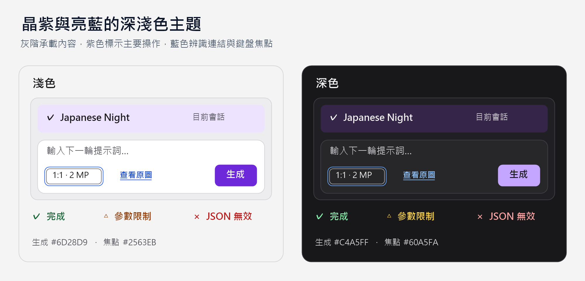

# Image Studio 設計系統

分享原規劃定義了工作區層級、緊湊側欄、圓角 Composer 與浮層形式。色彩 Token 已定義於全域樣式，字級、間距和動效為工作台規格。字體延用專案已載入的 Inter，繁中採系統字型回退。 [分享對話](https://chatgpt.com/s/t_6af936c20c808191bab8bad0d7c574fa) · [全域樣式](../react-project/app/app.css)

[功能規劃](./01-features.md) · [介面規格](./02-interface.md) · [技術架構](./04-architecture.md)

## 視覺層級

目前會話以底色與勾選符號標示，鍵盤焦點以外框呈現。完成、參數限制與 JSON 錯誤各有可讀的文字與圖示。

畫布、導航與側欄以淺灰或深灰建立層級。從紫晶星核的晶紫與亮藍取色，紫色用於生成及選取，藍色用於連結和鍵盤焦點。成功、警告與錯誤沿用各自的語意色，並搭配文字與圖示。Composer 使用較大的圓角、明確的輸入焦點與固定的生成操作位置。

## 色彩 Token

| Token | 淺色 | 深色 | 用途 |
|---|---|---|---|
| `surface-canvas` | `#F4F4F5` | `#18181B` | 會話畫布 |
| `surface-panel` | `#EDEDF0` | `#202024` | 功能導航、會話列表、歷史 |
| `surface-raised` | `#FFFFFF` | `#27272A` | Composer、Popover、Sheet |
| `surface-selected` | `#EDE3FF` | `#352548` | 選取及連結互動的淡紫底色 |
| `text-primary` | `#18181B` | `#F4F4F5` | 標題、本文、重要標籤 |
| `text-secondary` | `#52525B` | `#D4D4D8` | 說明、時間、圖片中繼資料 |
| `border-subtle` | `#D4D4D8` | `#3F3F46` | 裝飾分隔線 |
| `border-control` | `#71717A` | `#A1A1AA` | 需要明確邊界的輸入與操作項 |
| `action-primary` | `#6D28D9` | `#C4A5FF` | 生成等主要操作的紫色底色 |
| `action-primary-hover` | `#5B21B6` | `#D8C2FF` | 主要按鈕的滑鼠懸停底色 |
| `text-on-action` | `#FFFFFF` | `#18181B` | 主要按鈕文字 |
| `text-link` | `#1D4ED8` | `#93C5FD` | 可操作的藍色文字連結 |
| `focus-ring` | `#2563EB` | `#60A5FA` | 鍵盤操作焦點 |
| `status-success` | `#166534` | `#86EFAC` | 完成、JSON 有效 |
| `status-warning` | `#92400E` | `#FCD34D` | 參數限制、待處理提醒 |
| `status-error` | `#B91C1C` | `#FCA5A5` | 請求失敗、欄位錯誤 |

## 字體、間距與形狀

| 層級 | 規格 | 用途 |
|---|---|---|
| 會話標題 | 20 px / 28 px，600 | 當前會話 |
| 區塊標題 | 16 px / 24 px，600 | 側欄及浮層標題 |
| 本文 | 14 px / 22 px，400 | 工作區敘述、按鈕文字及提示詞。手機提示詞輸入採 16 px / 24 px。 |
| 輔助文字 | 12 px / 18 px，400 | 圖片版本、日期、尺寸 |
| 等寬字 | 13 px / 20 px，400，IBM Plex Mono 或系統等寬字 | JSON、Request Preview |

- 間距基準 4 px。使用 4、8、12、16、24、32 px 串接圖示、控制項、卡片及區塊。
- 圓角採 8 px 小型控制項、12 px 卡片與 Popover、16 px Composer 與浮動面板。狀態標籤採膠囊形，固定側欄用細分隔線。
- 觸控按鈕目標至少 44 × 44 px。鍵盤焦點使用 2 px 外框與間隔，確保相鄰元件可辨識。
- 浮層進出動效建議 160–220 ms。支援減少動態效果設定，關閉滑入與縮放，狀態立即可見。

## 元件與狀態

| 元件 | 規範 |
|---|---|
| 功能導航圖示 | 桌面滑鼠停留與鍵盤聚焦顯示名稱。每個圖示提供可存取名稱，當前功能有持續可辨識的選取樣式。 |
| 會話列表項 | 第一列顯示名稱，第二列顯示圖片數與時間。支援預設、停留、聚焦、目前會話及搜尋無結果。 |
| 參數控制項 | 設有預設、啟用、停用、聚焦、展開、無效。顯示摘要如 `PE 開啟`、`1:1 · 2 MP` 或 `Seed 隨機`。圖示輔助辨識。 |
| 圖片縮圖 | 網格用固定預覽框，Viewer 顯示完整比例。選取時同時顯示外框及勾選標記。載入失敗時保留位置，提供文字狀態。 |
| 參考圖項目 | 顯示縮圖、排序位置與移除操作。排序後更新可存取名稱，錯誤訊息指向個別附件。 |
| 生成結果 | 處理中、完成、失敗與取消使用一致的狀態位置。有確定進度時顯示進度值。 |
| 模式與連線 | Header 使用文字搭配狀態圖示，辨識 Standalone、LiteLLM、等待驗證、登入失敗及 Session 過期。 |
| 圖片比較器 | 為原圖與結果標示版本。分割線使用可聚焦的操作柄，支援鍵盤調整；同步縮放開關顯示目前狀態。 |
| Empty State | 會話、歷史與搜尋使用對應文案。歷史空白可用「這個會話還沒有圖片」，搜尋無結果可提供清除搜尋。 |
| JSON 編輯器 | 錯誤提示鄰接編輯器。可取得位置時標明行列，Request Preview 使用同一組等寬字與捲動規則。 |

## 視覺驗收

- 淺色及深色下檢查正文、圖示、選取、錯誤與焦點。一般文字對比目標至少 4.5:1，必要操作邊界及焦點指示目標至少 3:1。
- 在平板窄欄和手機放大文字時檢查長會話名稱、長 Seed、多張附件和錯誤文案。生成、關閉及移除仍可由鍵盤與觸控到達。
- 圖片載入、空狀態、無效 JSON、Provider 不可用與生成失敗使用同一套語意 Token 和可讀回饋。
