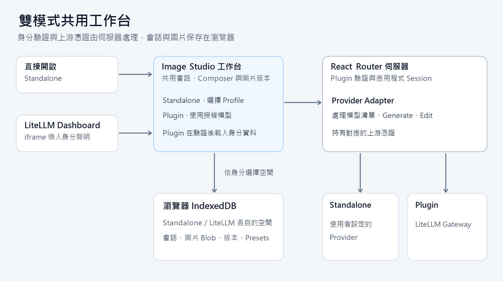

# Image Studio 技術架構

工作台共用 React、TypeScript、Vite 與 Tailwind，瀏覽器以 IndexedDB 儲存資料。`npm run build:static` 預先產生首頁及靜態資產，本機以 `http-server` 託管 `build-static/client`。LiteLLM Dashboard 使用這個靜態主機的 URL 開啟 iframe，`http-server` 將同源 API 請求轉送給本機 React Router 服務，由服務處理身分驗證、憑證及 Provider 請求。Dexie、Zustand、shadcn/ui 與 JSON 編輯器屬原規劃的技術選型。 [本機部署步驟](../react-project/README.md#在本機以-http-server-託管前端)

[功能規劃](./01-features.md) · [介面規格](./02-interface.md) · [設計系統](./03-design-system.md)

## 雙模式啟動

工作台將模型請求交給 React Router 伺服器。瀏覽器依啟動模式與驗證身分開啟對應的本機資料空間。

| 項目 | LiteLLM Plugin | Standalone |
|---|---|---|
| 啟動 | LiteLLM Dashboard 內嵌，完成 Plugin SSO 後啟用 | 直接開啟 Image Studio 網址 |
| 模型與 API | 後端管理 Gateway URL、授權及可用模型 | 使用者管理 Provider Profile、模型與端點 |
| 憑證 | Gateway Key 由後端保管 | 本機代理使用受保護設定或作業系統憑證儲存 |
| 資料空間 | 以驗證後的身分選擇 IndexedDB 命名空間 | 使用本機預設資料空間 |

### Plugin 註冊與身分交換

1. 在 LiteLLM 註冊 `image-studio` 的顯示名稱、部署 URL 和 `plugin_key`。Image Studio 於 `GET /api/plugin-manifest` 提供名稱、版本、導航項目及能力。
2. 直接開啟進入 `standalone`。iframe 先進入 `embedded-pending`，僅處理來自父視窗、來源在部署允許清單內的 `litellm-auth` 訊息。
3. 前端將 `session_claim` 送往 `POST /api/plugin-auth`。伺服器以插件專屬 `PLUGIN_AUTH_KEY` 驗證 Fernet 聲明、30 秒 TTL、到期時間、插件名稱及非空的 `user_id`、`user_role`，再簽發 Image Studio 自己的 Session。
4. 驗證成功進入 `litellm-authenticated` 並開啟該身分的資料空間。驗證失敗或 Session 過期分別進入 `auth-failed`、`session-expired`，停止該身分的請求，等待重新驗證。切換帳號時關閉前一身分的資料連線並清除工作台的記憶體狀態。

Gateway 依伺服器部署設定選擇服務 Key 或個別使用者的 Virtual Key。私人部署可採共用服務 Key；正式多人部署規劃優先採個別 Virtual Key，以支援各自模型權限與預算。LiteLLM 的 `plugin_key` 用於 LiteLLM 至插件後端的請求，`PLUGIN_AUTH_KEY` 用於驗證身分聲明，兩者用途各自獨立。實際 iframe 來源、Session 傳送方式及跨站儲存行為須在目標部署驗證。 [LiteLLM Plugins](https://docs.litellm.ai/docs/proxy/plugins)

## Provider Adapter 與請求

- 介面責任包含 `listModels`、`capabilities`、`generate`、`edit`。伺服器負責組合上游請求、處理認證、解析回應與轉譯錯誤。圖片結果與應用資料以一致的格式交給前端。
- Standalone 在 Profile 層解析 Base URL。使用預設路徑時補齊一次 `/v1`，保留使用者設定的路徑前綴及個別生成、編輯端點。模型偵測由代理帶入憑證呼叫 `GET /v1/models` 並取用 `data[].id`，提供手動模型與連線結果作為備援。
- LiteLLM 後端使用 `GET /v1/models`、`POST /v1/images/generations`、`POST /v1/images/edits`。部署權限允許時可用 `/model/info` 補充資訊。模型清單、手動設定及 Provider 能力表共同決定 Generate、Edit、多圖、Mask、自訂尺寸、Seed、PE 與 Responses 的可用性。 [LiteLLM Proxy API](https://docs.litellm.ai/api-reference)
- Image API 版本鏈由本機維護。Edit 可把任一父版本重新交給 Adapter。支援 Responses API 的模型可由 Adapter 透過 `previous_response_id` 延續上游上下文，並同步保存本機版本關係。 [OpenAI 圖片生成指南](https://developers.openai.com/api/docs/guides/image-generation)
- 依序建立系統預設值、合併 UI 值、處理 Extra Body。撞名時預設保留 UI 值且提示；明確啟用的進階覆寫只接受 Adapter 允許的欄位。Adapter 選擇 JSON 或 multipart 序列化，維持附件順序，並定義陣列、巢狀值與引用圖欄位的對應方式。
- Request Preview 以同一套合併與序列化規則呈現上游 URL、已遮蔽的 Headers、JSON 或 multipart 欄位。檢視 Response 時遮蔽敏感欄位，避免把憑證寫入 IndexedDB、備份或日誌。

### 解析度與 Seed

目標 MP 模式使用總像素數。給定來源寬高 `W`、`H` 與 `MP`，先算 `s = sqrt(MP * 1_000_000 / (W * H))`，再將 `W * s`、`H * s` 依 Adapter 的對齊單位各自取整。規劃以 16 作為可配置的初始對齊值，實際限制依模型。檢查取整後的邊長、比例及總像素是否符合模型能力，並回報最終尺寸或可修正原因。比例模式以長邊像素和選定比例等比換算另一邊，再依模型要求對齊。縮放流程保留完整畫面。自訂模式直接驗證明確輸入的寬高。

Seed 由 Adapter 檢查模型支援度、合法範圍及上游欄位映射。保存工作台送出的值與 Provider 回報值，若僅知道送出的值，畫面以送出值標示。PE 由獨立增強流程或 Provider 擴充處理。

## 本機資料模型

每個資料空間使用 IndexedDB 保存結構資料與圖片 Blob。本機 UI 偏好可用 LocalStorage。Plugin 資料空間依驗證身分分開，若同一部署接多個 LiteLLM Gateway，命名空間另納入 Gateway 識別。瀏覽器資料以裝置與站點儲存為界，依目標瀏覽器驗證 iframe 儲存與備份還原。

| 資料表 | 核心欄位 |
|---|---|
| `providers` | Profile ID、名稱、Base URL、模型、生成／編輯端點、能力規格、憑證引用 |
| `sessions` | 會話 ID、名稱、時間、置頂／封存狀態、Provider／模型及預設參數 |
| `messages` | 訊息 ID、會話 ID、順序、角色、文字及相關生成紀錄 |
| `images` | 圖片 ID、來源、Blob、縮圖、尺寸、格式、生成紀錄、父圖 ID 與收藏狀態 |
| `generation_runs` | 執行 ID、會話 ID、Prompt 各版本、模式、Provider、模型、參考圖順序、參數快照、狀態與結果 |
| `presets` | Preset ID、名稱、類型、作用模式及設定內容 |

成功的生成結果、圖片索引與會話關聯應一同保存，並以穩定 ID 讓重試或重載後可識別同一筆完成紀錄。清理前檢查會話、收藏、參考與父子版本關聯。匯出備份包含資料版本及 Blob，匯入先驗證版本與引用，並以選定的資料空間為目標。

## 伺服器路由與整合驗收

建議在現有路由設定註冊 `/api/plugin-manifest`、`/api/plugin-auth`、`/api/session`、`/api/models`、`/api/image-generate`、`/api/image-edit`。將 Plugin 驗證、Provider Adapter、生成流程及本機資料層放在各自的功能模組。Standalone 本機代理預設綁定 `127.0.0.1`。遠端部署需依部署方式設定存取控制及允許的 Provider 目的地。

- 直接開啟及內嵌登入可抵達各自模式。來源錯誤、過期聲明及空身分不得切入 Plugin。切換身分後檢查會話、圖片、Presets 及工作台草稿各自隔離。
- 測試模型清單、手動模型、生成 JSON 和編輯 multipart，核對順序、能力限制、衝突提示、Request Preview 與實際出站請求。
- 完成生成、重開、由舊圖編輯分支，再以備份還原至測試資料空間。核對圖片 Blob、父子關聯與生成快照。
