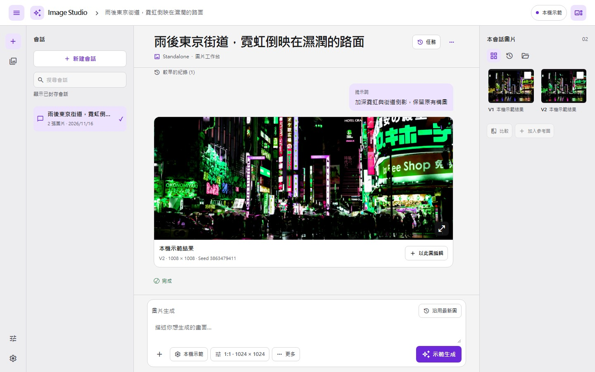
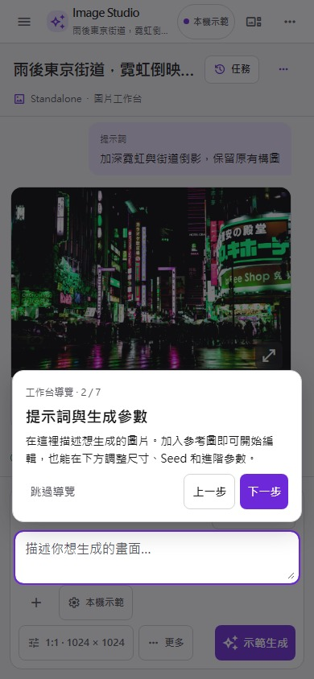

# Image Studio

Image Studio 是以會話整理圖片生成與多輪編輯的工作台。可直接開啟獨立版，先試用本機示範或連接自己的圖片模型，也可在 LiteLLM Dashboard 中以外掛方式使用。

## 工作台

- **會話與圖片庫**　依專案整理、搜尋、置頂及封存會話。從圖片庫取用其他會話的圖片，作為下一輪的參考圖。
- **圖片生成與編輯**　在底部輸入提示詞或加入參考圖，調整尺寸、Seed 及進階請求參數。送出後從任務佇列查看進度、取消或重試。
- **版本與比較**　在本會話圖片中查看生成和編輯版本。可選取兩張圖滑動比較、並排檢視多張圖，或從任一舊版開始新的編輯分支。
- **Provider 設定**　獨立版可儲存多組端點與模型設定。LiteLLM 外掛版使用 Gateway 提供的模型。
- **本機資料與備份**　會話、圖片和草稿儲存在瀏覽器。從「設定 → 本機資料管理」下載及還原完整備份，也可從會話管理單獨匯出會話。

工作區首次開啟時會自動播放導覽。可隨時跳過，也可從「設定 → 重新體驗導覽」重播。

### 桌面

左側是功能列及會話，中央顯示生成結果和底部的提示詞編輯區，右側可切換本會話圖片的檢視方式。



### 手機

手機版將會話與本會話圖片收進頂端按鈕開啟的抽屜。「更多功能」可開啟圖片庫及設定。下圖顯示導覽高亮提示詞輸入區時的畫面。



## 本機開發

使用 Node.js 24 和隨附的 npm。在 repository 根目錄執行以下命令。

```sh
cd react-project
npm ci
npm run dev
```

開啟 [http://localhost:5173](http://localhost:5173) 即可操作獨立版。本機示範可直接送出提示詞。要使用自己的圖片模型，從頂端「本機示範」開啟 Provider 設定，填寫 Base URL、API Key 和模型。瀏覽器直連的端點須允許工作台來源的 CORS 請求。

| 指令 | 用途 |
| --- | --- |
| `npm run typecheck` | 產生路由型別並檢查 TypeScript |
| `npm run build` | 建置伺服器版和 PWA 資產 |
| `npm run start` | 啟動建置完成的伺服器版 |
| `npm run build:static` | 建置可部署到靜態主機的獨立版 |
| `npm run start:static` | 在本機預覽靜態版 |

## LiteLLM 外掛部署

建議使用 Docker 從原始碼建置外掛版。容器會一併啟動工作台與 LiteLLM 身分驗證後端。

先在 repository 外建立 `image-studio.env`，填入 Dashboard 來源 `LITELLM_PARENT_ORIGINS`、工作台公開來源 `IMAGE_STUDIO_PLUGIN_ORIGIN` 與 `PLUGIN_AUTH_KEY`。若註冊時使用自訂外掛名稱，也要設定 `LITELLM_PLUGIN_NAME`。以下指令從 repository 根目錄執行，假設環境變數檔放在上一層。

```sh
docker build -t image-studio:local ./react-project
docker run -d --name image-studio --restart unless-stopped --env-file ../image-studio.env -p 127.0.0.1:3000:3000 image-studio:local
```

透過 HTTPS 反向代理公開工作台，再將公開網址登記到 LiteLLM Dashboard。完整環境變數、外掛註冊與預建映像用法請見 [LiteLLM Docker 部署說明](react-project/README.md#docker)。
